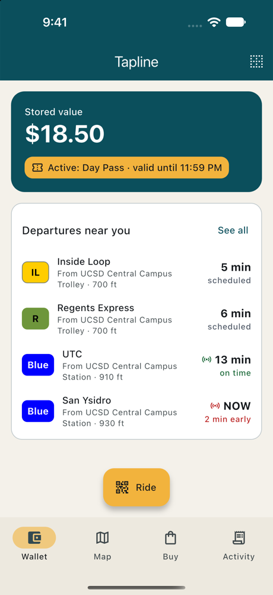
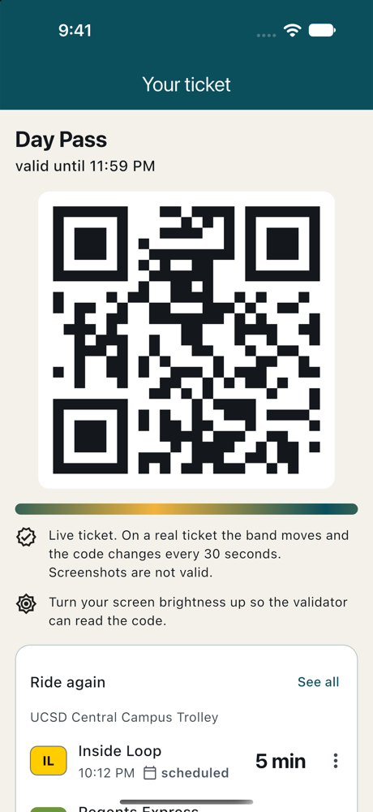
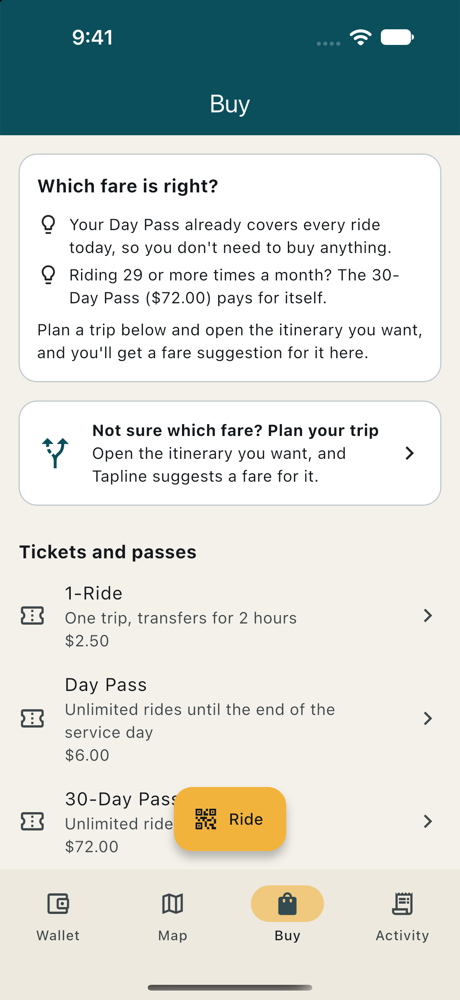
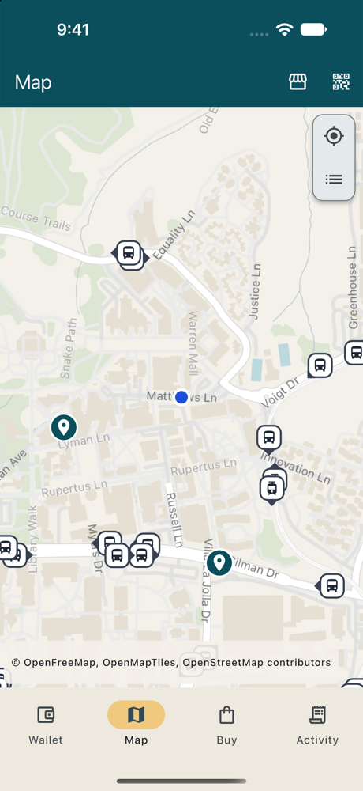
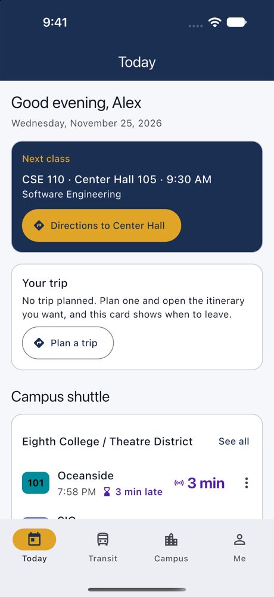
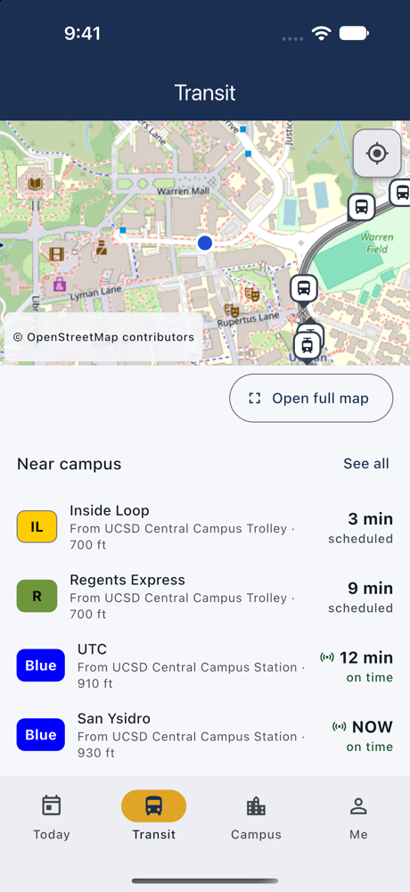
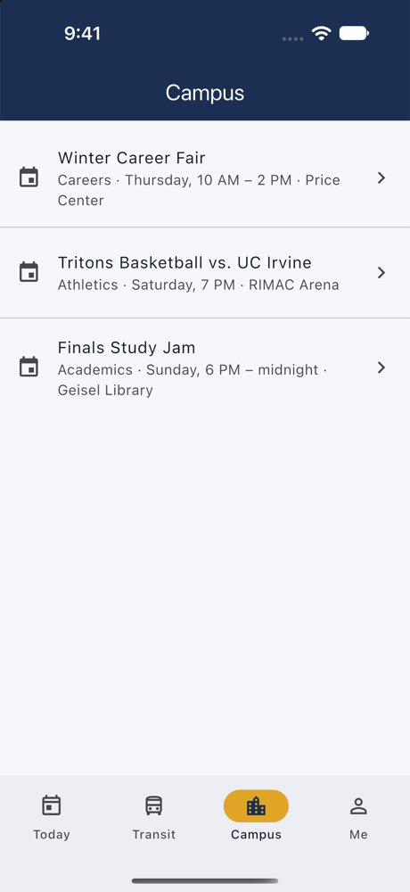

# Example apps

Two sample host apps show how the OneBusAway SDK (`package:obakit`) embeds
into someone else's product. Each app owns its own brand, navigation and
features. The SDK supplies the live transit parts: departures, alerts, the
map, the trip planner, and full stop and trip pages.

Both apps use live San Diego MTS data at a fixed point on the UC San Diego
campus, so they need no location permission. They are pub workspace
members: one `flutter pub get` at the repo root resolves them.

| App | What it is | More |
|---|---|---|
| [Tapline](tapline/) | A transit fare and payment app: wallet, ticket, ride, buy, activity, map | [`tapline/README.md`](tapline/README.md) |
| [Student Life](student_life/) | A university app: today's classes, campus transit, events, student ID | [`student_life/README.md`](student_life/README.md) |

## Tapline

A fictional fare app. The wallet, passes, checkout (always "Demo purchase,
no charge"), tap history and reload stores are Tapline's own code. The OBA
embeds sit where a rider decides what to do next.

| Wallet | Ride | Buy | Map |
|---|---|---|---|
|  |  |  |  |
| `ServiceAlertsSection` and `ObaNearbyStopsCard` under the host's balance card | `ObaStopDeparturesCard` for the stop of the last tap, titled "Ride again" with the stop's name under it | `TripPlannerRoute(onItinerarySelected:)`. The itinerary the rider opens drives a fare suggestion | `ObaMapView` with Tapline's reload stores added as map overlays |

## Student Life

A university app for UC San Diego that grows the first, minimal demo in
`packages/oba_arrivals/example`. Classes, dining, events and the student ID
are the host's. Transit comes from the SDK.

| Today | Transit | Campus |
|---|---|---|
|  |  |  |
| `ObaStopDeparturesCard` for the campus shuttle, `ServiceAlertsSection`, and a "Your trip" card fed by `onItinerarySelected` | `ObaMapView`, `NearbyStopsSection` ("Near campus") and `ObaBookmarksCard` | Each event's page has `ObaNearbyStopsCard(around: venue)` and opens the trip planner to the venue |

## How both apps embed the SDK

- **One `ObaApplication` and one `ObaScope`**, placed above the navigator in
  `MaterialApp.builder`. Every host route can then show SDK widgets, with
  no `ObaScope.rewrap`.
- **Host navigation for every SDK page.** `ObaScope.onNavigate` takes each
  `ObaRoute` and pushes `ObaRouteBuilder.build(context, route)` inside a
  host page. Stop, trip, itinerary, schedule and alert pages all appear
  under the host's own app bar.
- **The host learns the rider's choice.** `TripPlannerRoute(onItinerarySelected:)`
  hands the opened `Itinerary` to the host. Student Life turns it into
  "Leave by 9:00 AM · 1 Line"; Tapline turns it into a fare suggestion.
- **Show OBA embeds.** Each app has a toggle that outlines every SDK widget
  with its class name. In the code, each embed is marked with an
  `// OBA embed:` comment.

## Run them

```bash
mise install && mise exec -- flutter pub get   # once, from the repo root
cd examples/tapline                            # or examples/student_life
mise exec -- flutter run --dart-define=OBA_API_KEY=your-key
```

Without `OBA_API_KEY` both apps use the public test key
`org.onebusaway.iphone`.

CI runs both apps' tests. Each app's README covers its tests and wiring in
detail.
